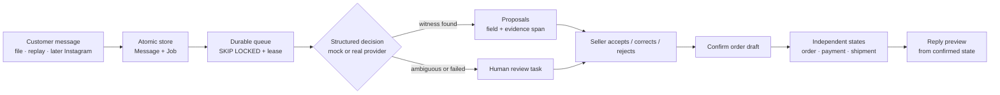

<p align="center">
  
</p>

<p align="center">
  <b>The order desk for Instagram sellers</b><br>
  <sub>Every DM finds its row.</sub>
</p>

<p align="center">
  <a href="README.md">🇮🇷 فارسی</a> ·
  <a href="#quick-start">Quick start</a> ·
  <a href="#screens-and-what-each-one-does">Screens</a> ·
  <a href="#configuration">Configuration</a> ·
  <a href="#deploying-to-vercel">Deploy</a>
</p>

---

## What it is

**Radif** is a work desk, not another dashboard. An Instagram seller receives
scattered DMs — "I paid", "where is the tracking code?", "I changed my address" —
and Radif turns that mess into **one clear queue of next actions**:

> message arrives → the system reads the requests → every proposed value shows its **witness in the message** → the seller confirms → the reply is written from the **confirmed** state.

The product in one line: **no value without a witness, no claim without a confirmation.** "I paid" creates a *payment claim*, never a verified payment. Confirming a draft order does not verify payment either.

Persian-first and RTL; English is the second language of the same UI. On a wide screen the queue, the thread and the action sheet sit side by side; on a phone it is one column with a bottom bar.

---

## Quick start

Requires **Node 22+**, **pnpm 10+**, **PostgreSQL 17**.

```bash
pnpm install
pnpm db:init        # Windows: portable PostgreSQL, no Docker
# or: docker compose up -d   (Postgres on 5435)
pnpm db:deploy
pnpm db:seed
pnpm dev            # http://localhost:3000 → /fa
pnpm worker         # second terminal: the queue worker
```

On an empty deployment (Vercel) nothing manual is needed: the first visit creates
the schema and seeds the demo shop (`src/server/ensure.ts`). To do it by hand:
open `/api/setup` once.

### Demo accounts

| Email | Role | Shop |
|---|---|---|
| `maryam@toranj.demo` | owner | Atelier Toranj |
| `saeed@toranj.demo` | operator | Atelier Toranj |
| `raha@raha.demo` | owner | Raha Shoe House (isolation proof) |

Password for all three: **`radif-demo-1405`**. Created only in demo mode.

**Language:** the EN / فا switch in the bar (and on the login panel) toggles the
locale at any time; routes are `/fa` and `/en`, so every screen is linkable.

---

## Roles (enforced on the server)

| Action | Owner | Operator |
|---|:---:|:---:|
| Queue, threads, orders, tasks, customers | ✅ | ✅ |
| Accept / correct / reject suggestions | ✅ | ✅ |
| Confirm an order draft | ✅ | ✅ |
| Record tracking code and shipment status | ✅ | ✅ |
| **Verify or dispute a payment** | ✅ | ❌ (403 from the server) |
| **Sensitive settings** (hours, SLA, shipping pause, rates) | ✅ | ❌ |
| **Reset the demo data** | ✅ | ❌ |

Roles live on `Membership`, per shop. Hiding a button is not the control: the
service and the route both check.

> A **customer** role does not exist yet, by design: the first phase-4 step is a
> private order-status link (random, hashed, expiring token) and it is still
> backlog. No "ready" badge for a feature that is not built.

---

## Screens and what each one does

1. **Today** — the queue owns the screen. Three real counters (open, overdue,
   needs review), a ledger with *why it is here / next action / due*, **assignee
   and due filters in the URL** (all · mine · unassigned × all · overdue · next
   24h · next 7 days), a 24-hour signal rail of real message volume, and one
   primary action: start with the top row. The counters stay global on purpose.
2. **Inbox** — queue · thread with the evidence underline · proposals sheet. A
   hairline runs from a selected field to the exact span in the customer's
   message. Review states: proposed / accepted / corrected / rejected. Reply
   preview is always a preview; it never claims "sent".
3. **Orders** — list + detail with items, payment, shipment, tasks and history.
   Three independent state machines (order, payment, shipment) on one screen;
   editable draft with optimistic locking (two writers → 409); confirming a draft
   touches nothing else.
4. **Tasks** — assignee, due, status, reason and links back to the message or
   order; overdue computed from the due date, never from tone. Closing a task
   releases its dedupe key.
5. **Customers** — internal id, known channel identities, phone verification,
   orders and one merged timeline. Identities are never auto-merged.
6. **Import** — JSON/CSV with a preview of accepted and rejected rows and the
   reason for each rejection; limits 5 MB / 5 000 rows; re-importing the same
   file adds zero messages.
7. **Settings** — working hours, SLAs, price freshness, **posting pause** and
   **shipping pause** as two separate decisions, real connection status ("ready to
   configure; live connection not tested"), catalogue with last price
   confirmation, dated evaluation rates, and "next phase" labels with no dead
   buttons.
8. **Evaluation** — one table of `AnalysisRun`: provider, model, prompt/rules
   version, queue-to-render time, attempts, tokens, cost and the dated rate.
   Anything the provider did not report is **"unknown"**, never zero.
9. **Login / sign-up** — email + password (Better Auth), one-click demo accounts,
   errors that distinguish an untrusted origin from bad credentials, a rate limit
   and a network failure. Sign-up creates the user's own shop (tenant + owner
   membership) in the same request.
10. **Last-resort screens** — loading, error, 404 inside and outside a locale,
    all on brand.

---

## The loop



Locked in code and tests: duplicate delivery → one message; a payment claim is
never auto-verified; confirming a draft does not touch payment or shipment;
multi-intent messages keep every intent; two open orders never get a random
association; a missing tracking code is never invented; an amount without a unit
is never converted; an address change after shipping goes to a human; text inside
a DM is data, never an instruction; another tenant's id is a 404; a model timeout
keeps the message and opens a review task; a worker restart duplicates nothing;
two concurrent edits produce a visible 409.

---

## Configuration

Everything lives in `.env` (copy `.env.example`). No key reaches the client
bundle and none is logged.

| Variable | Values | Meaning |
|---|---|---|
| `APP_MODE` | `demo` · `production` | demo seeds, replays and resets; production refuses all three |
| `INGESTION_MODE` | `replay` · `file` · `live` | where messages come from |
| `DECISION_PROVIDER` | `mock` · `typesafe` | `mock` is deterministic and keyless; production refuses it |
| `TYPESAFE_MODEL` | `jev-1.14.0` | structured-decision model |
| `TYPESAFE_API_KEY` | empty | the real provider refuses to start without it |
| `DRAFT_PROVIDER` | `none` · `template` | draft text generation |
| `OUTBOUND_MODE` | `preview` · `live` | phase 2 is preview only |
| `LIVE_AUTOMATION_ENABLED` | `false` | the master switch for sending |
| `DATABASE_URL` | — | PostgreSQL; on Vercel it must be a cloud database |
| `BETTER_AUTH_SECRET` / `BETTER_AUTH_URL` | — | session and trusted origin |
| `CHANNEL_TOKEN_ENC_KEY` | — | AES-256-GCM sealing for channel tokens |
| `WORKER_POLL_MS` | — | queue poll interval |
| `RATE_LIMIT_LOGIN_PER_MIN` / `RATE_LIMIT_IMPORT_PER_MIN` | — | login and import limits |

---

## Demo data

Two isolated shops, 16 conversations (13 in the first), 5 orders
(`DEMO-ORD-1042`, `-1039`, `-1031`, `-1027`, `-0998`), 11 tasks, 5 evidence-backed
proposals, payment claims and shipments in several states, an audit trail, and
colloquial Persian messages with Persian/Arabic digits, typos, multi-intent
requests, incomplete addresses and one prompt-injection attempt.

The scripted message:

> **Negar Ahmadi · 21:04** — "I paid, are you sending the tracking code? My address changed too, you still haven't shipped?"

Three requests are read from that one message, linked to the existing order, and
the new address stays empty because the customer never stated it.

Reset: Settings → "reset demo data", or `POST /api/demo/reset` (owner, demo only).

---

## Scripts

`pnpm dev` · `pnpm build` · `pnpm start` · `pnpm typecheck` · `pnpm lint` ·
`pnpm test` · `pnpm e2e` · `pnpm worker` · `pnpm worker:once` ·
`pnpm db:init|start|stop|status|deploy|migrate|seed|studio|reset` ·
`pnpm design:shots`

---

## Quality gates

| Gate | Result |
|---|---|
| `tsc --noEmit` | 0 errors |
| `pnpm lint` | 0 errors |
| `pnpm build` | passes |
| `pnpm test` | **10 files, 86 tests, all green** against a real `radif_test` database |
| Design scan | every screen at 1440 / 390 / 320, no FAILs |
| Worker | `worker:once` drains cleanly; re-running recovers 0 |

---

## Deploying to Vercel

1. Create a cloud Postgres (Neon / Supabase / Vercel Postgres) and set
   `DATABASE_URL`.
2. Set `BETTER_AUTH_SECRET` (16+ chars) and `BETTER_AUTH_URL` (your domain).
3. Deploy. The first visit provisions the schema and the demo shop; `/api/setup`
   does the same on demand.
4. Run `pnpm worker` somewhere that can reach the same database — a Vercel
   serverless function does not stay alive for a queue.

Seeing "the database is not ready" means `DATABASE_URL` is missing or points at a
local host; `127.0.0.1` is unreachable from Vercel. Fix the variable, redeploy,
open the app once.

---

## Design and brand

The client's palette, unchanged: `#000014` night · `#0B0B3F` surface ·
`#11115A` raised · `#333377` rule · `#FF852E` the lamp (one job: primary action,
"needs you now", the evidence span) · `#ECECF6` ink · `#B5B6DD` muted.
**Peyda**, nine weights, self-hosted as WOFF2; Latin and digits from Peyda
itself; machine values in mono, LTR-isolated. The supplied brand lockup lives in
`brand/source/` and every icon is generated from it by `scripts/brand-assets.py`
(brand orange `#F87820` is never recoloured). Direction in `DIRECTION.md`,
critique in `CRITIQUE.md`, spec conformance in `docs/CONFORMANCE.md`.

---

## Project structure

```
prisma/            schema, migrations (tenant-integrity guards), seed
src/app/[locale]/  FA/EN routes: Today, Inbox, Orders, Tasks, Customers…
src/app/api/       25 REST routes for client mutations and tests
src/components/    shell, brand, primitives, screen bodies
src/server/        domain · providers · channels · ingestion · services · worker
src/i18n/          locale config, formatting (digits/dates/money), fa/en dictionaries
docs/              CONTRACTS · PHASES · CONFORMANCE · DEMO · OPTIMIZATION
brand/             supplied brand files + icon pipeline
explore/ · shots/  design process evidence
scripts/           pg-local.ps1 · brand-assets.py · design-shots.mjs
```

---

## Roadmap, honestly

| Phase | State |
|---|---|
| 1–2: message → draft, confirmation, today queue | ✅ built and tested |
| 3: official Instagram connection | ❌ contract ready; live connection not tested |
| 4: customer identity, order-status link, OTP | ❌ backlog |
| 5: follow-up and marketing | ❌ backlog (internal seller reminders exist in phase 2) |

Details and acceptance criteria: [`docs/PHASES.md`](docs/PHASES.md).

---

<p align="center">
  <sub>All demo data is synthetic and prefixed <code>DEMO-</code> so it can never be mistaken for a real shop's records. ·
  <a href="README.md">خواندن به فارسی</a></sub>
</p>
