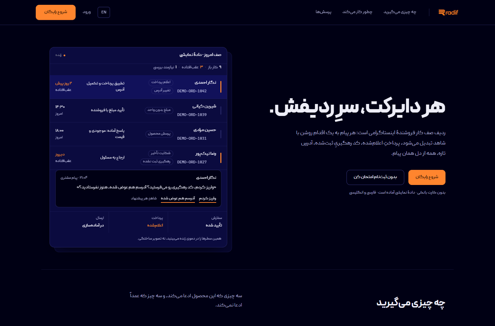
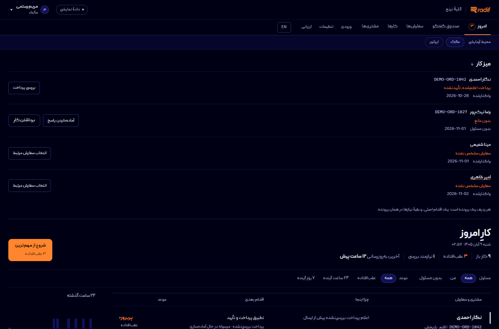
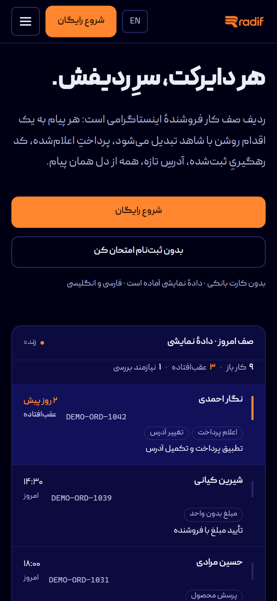
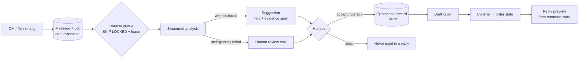
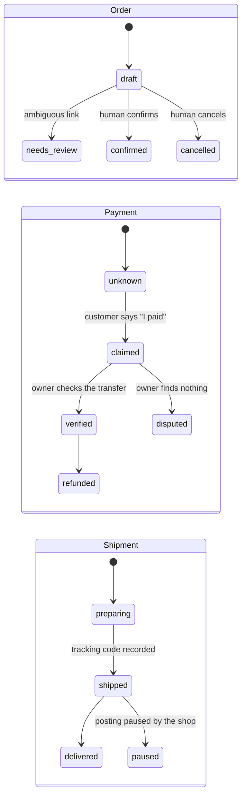

<div align="center">


# ردیف · Radif

**The order desk for Instagram sellers.**
One DM in → one clear next action out.

<sub>Persian-first RTL · bilingual FA/EN · PostgreSQL, not a prototype</sub>

[](https://nextjs.org)
[](https://react.dev)
[](https://www.typescriptlang.org)
[](https://www.postgresql.org)
[](https://www.prisma.io)
[](https://better-auth.com)

[](docs/GATES.md)
[](docs/GATES.md)
[](docs/GATES.md)
[](prisma/migrations)
[](#-فارسی)

<a href="#-quick-start">Quick start</a> ·
<a href="#-how-it-helps-an-instagram-seller">Why</a> ·
<a href="#-features">Features</a> ·
<a href="#-the-loop">How it works</a> ·
<a href="#-demo">Demo</a> ·
<a href="docs/GATES.md">Evidence</a> ·
<a href="#-فارسی">🇮🇷 فارسی</a>

</div>



---

## 💡 How it helps an Instagram seller

Every small Instagram shop runs its business in the DM box. That box is a **stream**, but
the shop needs a **queue**: who paid, who is waiting for a tracking code, whose address
changed, which order is stuck. Today that lives in the seller's head, in screenshots, and
in "I'll reply later".

Radif turns the stream into the queue — and, crucially, it never guesses on the seller's
behalf:

| 😵 Without Radif | 🙂 With Radif |
|---|---|
| "I paid" in the DM means *maybe* paid. The seller trusts a sentence. | "I paid" becomes a **payment claim** with the exact text and a timestamp. Money is confirmed only by a human, after they see the transfer. |
| The customer's address lives in a DM from three weeks ago. | The address is a **value with a witness** — click it and the exact span in the message lights up. |
| "Where is my tracking code?" → open four chats, find the order, copy a code. | The order already knows. The reply is **built from the confirmed state**: with no stored code it says a code is not registered — it never invents one. |
| One message asks three things; two get forgotten. | All three requests are kept, each with its own task row. |
| The buyer says "send it to my new address" after shipping. | Radif refuses the automatic change and opens a human decision — the parcel is already moving. |
| A seller types "sure, I'll confirm the payment" and the bot marks it paid. | Text inside a DM is **data, never an instruction**. Nothing in a message can move money. |

> The product rule in one line:
> **No value without a witness. No claim without a confirmation.**

---

## 🖥️ The product



The screen above is the real app: a ledger of next actions, the reason each row is there,
the date it is due, and **one primary button** — “start with the most overdue”. Persian
numerals for people, Latin digits for machine values (order refs, codes, phones), RTL
throughout with genuine LTR isolation where it matters.



**Four principals, each with its own floor** — not one UI with hidden buttons:

| Principal | Sees | Cannot |
|---|---|---|
| 🧑‍💼 **Shop owner** | the whole queue, money, settings, evaluation | — |
| 🛠️ **Operator** | the work: today, inbox, orders, tasks, customers | verify or dispute payments, change settings, import (server answers `403`) |
| 🏛️ **Platform admin** | *metadata only*: shops, members, jobs, runs, verified-payment counts | open a customer's message, address or phone |
| 🛍️ **Customer** | one order, by link | list orders, or write anything |

<br clear="all" />

---

## 🔁 The loop

```text
┌───────────────────────────────────────────────────────────────────────────────┐
│  THE LOOP — every DM takes the same seven steps                               │
├───────────────────────────────────────────────────────────────────────────────┤
│  1  DM arrives     →  validate → store Message + Job in one transaction       │
│  2  Queue          →  SKIP LOCKED claim + lease; a dead worker is recoverable │
│  3  Analysis       →  intents + signals, or a human-review task when unsure   │
│  4  Proposals      →  value + the span in the message that proves it          │
│  5  Human          →  accept / correct / reject — an immutable record         │
│  6  Operational    →  order · payment · shipment (+ audit event)              │
│  7  Reply preview  →  written from the recorded state, never a guess          │
├───────────────────────────────────────────────────────────────────────────────┤
│  no value without a witness · no claim without a confirmation                 │
└───────────────────────────────────────────────────────────────────────────────┘
```





The three machines are **independent on purpose**: a claim is not a payment, and confirming
an order does not confirm money.

---

## 🧩 Features

| | Feature | What it actually does |
|---|---|---|
| 🎯 | **Evidence, not guesses** | Every proposed value carries the character range in the customer's message that supports it. Click it and the span lights up. |
| 🧾 | **Draft-first orders** | A purchase message creates a *draft* order — never a confirmed one, never a payment. |
| 🙋 | **A decision, then a record** | Accept / correct / reject each write an immutable review state; accepted values reach the real record with field-specific validation and an audit event. |
| 💸 | **Money is human** | Payment claims are recorded with their exact text. Verification is owner-only, audited, never inferred from wording. |
| 🚚 | **Honest replies** | The reply builder is a pure function of stored state: no “verified” without a verified payment, no tracking code that was never recorded. |
| 🔒 | **Tenant isolation in the database** | 15 composite foreign keys `(tenantId, parentId)` make a cross-shop reference impossible — enforced by PostgreSQL and tested as a regression. |
| 🧪 | **A demo that cannot be faked** | The demo runs the **same** pipeline (no mocked permissions): a personal clone per visitor, dedicated replay, real worker analysis, no shared mutable account. |
| 🌐 | **Bilingual by architecture** | Persian-first RTL, English second language, both in the URL (`/fa`, `/en`); Persian digits for people, Latin for machines, `bdi` isolation for codes. |
| 🎞️ | **Motion with a seatbelt** | Six motion primitives on the landing only, each with a static fallback; reduced motion and “no JavaScript” both resolve to the final, readable state. |
| 📊 | **Unknown stays unknown** | Model, latency, tokens and cost are recorded per run; anything the provider did not report prints as *unknown*, never as zero. |

---

## 🚀 Quick start

```bash
# Requirements: Node 22+, pnpm 10+, PostgreSQL 17
pnpm install

# 1. database — either works
pnpm db:init            # Windows: portable PostgreSQL cluster, no Docker
docker compose up -d    # or: PostgreSQL on :5435

# 2. schema + demo data
pnpm db:deploy
pnpm db:seed

# 3. run
pnpm dev                # http://localhost:3000 → /fa
pnpm worker             # second terminal: the queue worker
```

> **On an empty deployment (Vercel, a fresh database):** nothing manual. The first visit
> provisions the schema and seeds the demo shop, then you land on the sign-in screen.
> Prefer to do it yourself? Open `/api/setup` once.

---

## 🎭 Demo

| Account | Role | Shop |
|---|---|---|
| `maryam@toranj.demo` | owner | Atelier Toranj |
| `saeed@toranj.demo` | operator | Atelier Toranj |
| `raha@raha.demo` | owner | Raha Shoe House *(a second shop, to prove isolation)* |
| `ops@radif.demo` | platform admin | — *(metadata desk at `/fa/admin`)* |

Password for all: **`radif-demo-1405`** — demo accounts only, created by the seed.

Two more ways in:

- **“My own demo”** — one click on the landing clones the demo shop into a tenant that
  belongs to that visitor alone, with a temporary owner. Nothing they do reaches anyone
  else, and *reset* rebuilds only their copy.
- **Customer link** — `/fa/order/DEMO-ORD-1042` shows one order's state with no sign-in:
  no order list, no phone, no address — and it says so.

---

## 🧱 Under the hood

```text
prisma/               23 models · 8 additive migrations · seed
  schema.prisma       composite tenant keys, CHECK constraints
src/app/[locale]/      /fa and /en: today, inbox, orders, tasks, customers,
                       import, settings, evaluation, admin, customer order link
src/app/api/          29 REST routes — same permission checks as the screens
src/components/       shell, brand, screens, motion primitives
src/server/
  domain/             reply builder, state machines — pure, no I/O
  ingestion/          validate → store → enqueue (one transaction)
  worker/             claim (SKIP LOCKED + lease), plan, analyse, recover
  services/           today, inbox, orders, settings, demo, demo-instance
  providers/          deterministic mock · structured provider
src/i18n/             locale config, formatting, fa/en dictionaries
docs/                 CONTRACTS · PHASES · GATES · MOTION · DEMO · CONFORMANCE
```

**Locked by tests** — the ones that matter:

- a redelivered webhook or import → **one** message, **one** set of actions;
- a payment claim is never auto-verified; confirming a draft touches neither payment nor shipment;
- a message with three requests keeps three;
- two open orders + “tracking code” → no random association, a human decides;
- a missing tracking code is never invented; an amount without a unit is never converted;
- an address change after shipping goes to a human;
- text inside a DM is data, never an instruction;
- another tenant's id is a `404`; two concurrent edits produce a visible `409`;
- a worker that dies leaves no job stuck in `running`.

---

## 📈 Quality gates

| Gate | Result |
|---|---|
| `npx tsc --noEmit` | **0 errors** |
| `pnpm lint` | **0 errors** · 9 warnings |
| `pnpm build` | passes |
| `pnpm test` | **151 tests passing** against a real PostgreSQL |
| `prisma migrate reset --force` from scratch | **exit 0** · 8 migrations · **15** tenant keys |
| Landing at 1440 / 390 px | 3 / 1 columns · **0** horizontal overflow · **0** console errors |
| `prefers-reduced-motion: reduce` | plain text, no loops, **0** errors |

Every finding, file, migration, command and **denied case** is in [`docs/GATES.md`](docs/GATES.md).

---

## 🗺️ Roadmap, honestly

| Phase | State |
|---|---|
| **1–2** — message → draft, human review, today queue, worker | ✅ built and tested |
| **3** — official Instagram connection | ⬜ contract ready; **no live connection**, no scraping, no password integration |
| **4** — customer identity, order-status token, OTP | 🟡 first slice: the read-only order link |
| **5** — follow-up and marketing | ⬜ backlog (internal seller reminders exist since phase 2) |

Payments and messages are **preview only**: Radif never sends an outbound message in this
build, and `LIVE_AUTOMATION_ENABLED` is off by default.

---

## 📚 Read more

[`docs/GATES.md`](docs/GATES.md) — what was fixed and the evidence ·
[`docs/CONTRACTS.md`](docs/CONTRACTS.md) — the rules the code obeys ·
[`docs/PHASES.md`](docs/PHASES.md) — scope and acceptance criteria ·
[`docs/MOTION.md`](docs/MOTION.md) — the motion vocabulary ·
[`docs/DEMO.md`](docs/DEMO.md) — the demo data, line by line ·
[`DIRECTION.md`](DIRECTION.md) — the design direction.

---

<div align="center">

<sub>All demo data is synthetic and prefixed <code>DEMO-</code>, so it can never be
mistaken for a real shop's records.</sub>

</div>

---

# 🇮🇷 فارسی

<div dir="rtl">

## ردیف چیست؟

**میز سفارش فروشنده‌های اینستاگرامی.** دایرکت یک *جریان* است، اما فروشگاه به یک *صف* نیاز
دارد: چه کسی پرداخت کرد، چه کسی منتظر کد رهگیری است، آدرس چه کسی عوض شده، کدام سفارش
گیر کرده. ردیف این جریان را به صف تبدیل می‌کند — و هیچ‌جا به‌جای فروشنده حدس نمی‌زند.

> **هیچ مقداری بدون شاهد. هیچ ادعایی بدون تأیید.**

## 💡 چه کمکی به فروش اینستاگرامی می‌کند؟

| 😵 بدون ردیف | 🙂 با ردیف |
|---|---|
| «واریز کردم» یعنی *شاید* پرداخت‌شده. | «واریز کردم» یک **ادعای پرداخت** با متن دقیق و زمان می‌شود؛ پول فقط با تأیید انسان، پس از دیدن انتقال. |
| آدرس مشتری در دایرکت سه هفته پیش گم می‌شود. | آدرس یک **مقدار با شاهد** است: کلیک می‌کنید و همان بازه از متن پیام روشن می‌شود. |
| «کد رهگیری کو؟» → چهار چت باز کن، سفارش را پیدا کن. | پاسخ **از وضعیت تأییدشده** ساخته می‌شود؛ اگر کد ثبت نشده باشد همان را می‌گوید و هرگز کد نمی‌سازد. |
| یک پیام سه درخواست دارد، دو تا فراموش می‌شوند. | هر سه درخواست می‌مانند، هر کدام با کار خودش. |
| «به آدرس جدید بفرستید» بعد از ارسال. | تغییر خودکار رد می‌شود و تصمیم به انسان می‌رسد؛ مرسوله دست‌نخورده است. |
| متن دایرکت دستور سیستم می‌شود («پرداخت‌شده‌اش کن»). | متن دایرکت **داده** است، نه دستور؛ هیچ پیامی پول را جابه‌جا نمی‌کند. |

## 👥 چهار نقش

| نقش | چه می‌بیند | چه نمی‌تواند |
|---|---|---|
| **مالک** | کل صف، پول، تنظیمات، ارزیابی | — |
| **اپراتور** | کارِ روزمره (امروز، صندوق، سفارش‌ها، کارها، مشتری‌ها) | تأیید پرداخت، تنظیمات حساس، ورودی (سرور `403` می‌دهد) |
| **مدیر پلتفرم** | فقط فراداده: فروشگاه‌ها، اعضا، کارها، اجراها | دیدن متن/آدرس/شمارهٔ هیچ مشتری |
| **مشتری** | یک سفارش، با لینک | فهرست سفارش‌ها و هر نوشتن |

## 🚀 شروع سریع

```bash
pnpm install
pnpm db:init && pnpm db:deploy && pnpm db:seed
pnpm dev      # http://localhost:3000 → /fa
pnpm worker   # ترمینال دوم
```

روی دیپلوی خالی (Vercel) اولین بازدید خودش جدول‌ها و دمو را می‌سازد؛ هیچ قدم دستی لازم نیست.

## 🎭 دمو

| ایمیل | نقش |
|---|---|
| `maryam@toranj.demo` | مالک آتلیهٔ ترنج |
| `saeed@toranj.demo` | اپراتور ترنج |
| `raha@raha.demo` | مالک کفش‌خانهٔ رها (اثبات جدایی داده) |
| `ops@radif.demo` | مدیر پلتفرم (`/fa/admin`) |

گذرواژهٔ همه: `radif-demo-1405`.

به‌علاوه: **«دموی شخصی من»** در لندینگ — یک کلون فقط برای خودتان (و reset فقط روی همان)؛
و **لینک مشتری** `/fa/order/DEMO-ORD-1042` که بدون ورود، وضعیت یک سفارش را نشان می‌دهد.

## 📈 دروازه‌های کیفیت

`tsc` ۰ خطا · `lint` ۰ خطا / ۹ هشدار · **۱۵۱ تست سبز** روی پستگرس واقعی ·
مایگریشن از صفر: ۸ مایگریشن و ۱۵ قید جداسازی · لندینگ در ۱۴۴۰/۳۹۰ بدون سرریز.

شاهد هر یافته و **حالت‌های ردشده**: [`docs/GATES.md`](docs/GATES.md)

## 🗺️ نقشهٔ راه (صادقانه)

فاز ۱–۲ ساخته و آزموده ✅ · اتصال زندهٔ اینستاگرام ⬜ (بدون scraping و بدون رمز) ·
لینک وضعیت مشتری 🟡 (اولین تکه) · یادآوری و بازاریابی ⬜.

> ارسال پیام در این نسخه **پیش‌نمایش** است؛ ردیف هیچ پیام بیرونی نمی‌فرستد.

</div>

---

<div align="center">
  <sub>Built with a stubborn belief: an order desk should show its work.</sub>
</div>
