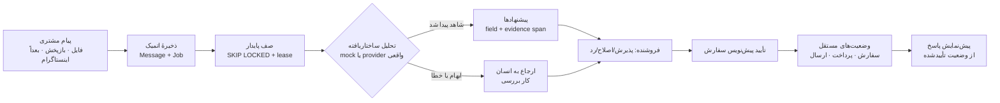

<p align="center">
  
</p>

<p align="center">
  <b>میز سفارش فروشگاه‌های اینستاگرامی</b><br>
  <sub>هر دایرکت، سرِ ردیفش.</sub>
</p>

<p align="center">
  <a href="README.en.md">🇬🇧 English</a> ·
  <a href="#شروع-سریع">شروع سریع</a> ·
  <a href="#صفحه‌ها-و-هر-گزینه‌شان">صفحه‌ها</a> ·
  <a href="#تنظیمات-و-همهٔ-گزینه‌ها">تنظیمات</a> ·
  <a href="#استقرار-روی-ورکل">استقرار</a>
</p>

---

## این چیست؟

**ردیف** یک میز کار است، نه یک داشبورد دیگر. فروشندهٔ اینستاگرامی پیام‌های پراکنده را در دایرکت می‌گیرد — «واریز کردم»، «کد رهگیری کو؟»، «آدرسم عوض شد» — و ردیف این پراکندگی را به **یک صف روشن از اقدام‌های بعدی** تبدیل می‌کند:

> پیام مشتری می‌آید ← سیستم درخواست‌ها را می‌فهمد ← برای هر مقدار **شاهد** نشان می‌دهد ← فروشنده تأیید می‌کند ← پاسخ از روی وضعیت **تأییدشده** نوشته می‌شود.

اصل محصول در یک جمله: **هیچ مقداری بدون شاهد، و هیچ ادعایی بدون تأیید.** «واریز کردم» یک **ادعای پرداخت** می‌سازد، نه پرداخت تأییدشده. تأیید پیش‌نویس سفارش هم پرداخت را تأیید نمی‌کند.

**برای چه کسی؟** فروشنده و یک اپراتور در فروشگاه کوچکی که سفارش‌ها را در دایرکت می‌گیرد. زبان کاری فارسی و راست‌به‌چپ است؛ انگلیسی زبان دوم همان رابط است. در دسکتاپ عریض: صف، متن گفتگو و پنل اقدام کنار هم؛ در موبایل: یک ستون با نوار پایین.

---

## شروع سریع (۳ دقیقه)

پیش‌نیاز: **Node 22+**، **pnpm 10+** و یک **PostgreSQL 17**.

```bash
pnpm install

# ۱) دیتابیس — یکی از دو راه:
pnpm db:init          # ویندوز: پستگرس پرتابل را می‌سازد و بالا می‌آورد (بدون داکر)
# یا: docker compose up -d     ← پستگرس روی پورت ۵۴۳۵

# ۲) جدول‌ها + دادهٔ نمایشی
pnpm db:deploy
pnpm db:seed

# ۳) اجرا
pnpm dev              # http://localhost:3000  → خودش به /fa می‌رود
pnpm worker           # ترمینال دوم: پردازش صف (تحلیل پیام)
```

> **روی دیپلوی خالی (مثل Vercel):** لازم نیست کار خاصی بکنی. اولین بازدید، خودش جدول‌ها را می‌سازد و فروشگاه دمو را seed می‌کند (`src/server/ensure.ts`). اگر دستی بخواهی: `/api/setup` را یک‌بار باز کن.

### حساب‌های دمو

| ایمیل | نقش | فروشگاه |
|---|---|---|
| `maryam@toranj.demo` | مالک | آتلیهٔ ترنج |
| `saeed@toranj.demo` | اپراتور | آتلیهٔ ترنج |
| `raha@raha.demo` | مالک | کفش‌خانهٔ رها (اثبات جدایی داده) |

گذرواژهٔ هر سه: **`radif-demo-1405`**. این حساب‌ها فقط در حالت دمو ساخته می‌شوند و به هیچ حساب واقعی دسترسی ندارند.

**زبان:** از دکمهٔ «EN / فا» در نوار بالا (و گوشهٔ صفحهٔ ورود) هر لحظه زبان عوض می‌شود؛ مسیرها `/fa` و `/en` هستند، پس هر صفحه لینک‌شدنی است.

---

## نقش‌ها و دسترسی‌ها (کنترل سمت سرور)

| کار | مالک | اپراتور |
|---|:---:|:---:|
| دیدن صف، گفتگوها، سفارش‌ها، کارها، مشتری‌ها | ✅ | ✅ |
| تأیید/اصلاح/رد پیشنهادهای سیستم | ✅ | ✅ |
| تأیید پیش‌نویس سفارش | ✅ | ✅ |
| ثبت کد رهگیری و وضعیت ارسال | ✅ | ✅ |
| **تأیید یا رد پرداخت** | ✅ | ❌ (۴۰۳ از سرور) |
| **تغییر تنظیمات حساس** (ساعت کاری، SLA، توقف ارسال، نرخ) | ✅ | ❌ |
| **بازنشانی دادهٔ نمایشی** | ✅ | ❌ |

نقش‌ها روی `Membership` و **به‌ازای هر فروشگاه** ذخیره می‌شوند؛ یک نفر می‌تواند در یک فروشگاه مالک و در فروشگاه دیگر اپراتور باشد. مخفی‌کردن دکمه کافی نیست: سرویس و روت هر دو اجازه را بررسی می‌کنند.

> **نقش «مشتری»** امروز وجود ندارد و عمداً ساخته نشده: طبق سند، اولین قدم فاز ۴ یک **لینک خصوصی وضعیت سفارش** است (توکن تصادفی، هش‌شده، با انقضا) که فعلاً در بک‌لاگ است.

---

## صفحه‌ها و هر گزینه‌شان

### ۱) امروز — «الان چه کاری؟»
- سه شمارندهٔ **واقعی** از دیتابیس: کار باز، عقب‌افتاده، نیازمند بررسی.
- صف کار به‌صورت دفتر: هر ردیف **چرا اینجاست**، **اقدام بعدی**، **موعد** و نشان منبع (بازپخش/فایل).
- **فیلتر مسئول و موعد** در URL: همه/من/بدون مسئول × همه/عقب‌افتاده/۲۴ ساعت آینده/۷ روز آینده.
- نوار کنار: تراکم واقعی پیام‌های ۲۴ ساعت گذشته (هر میله یک ساعت) + میانگین پاسخ.
- دکمهٔ «شروع از مهم‌ترین» → مستقیم به بالاترین اولویت.
- عددهای بالای صفحه عمداً با فیلتر عوض نمی‌شوند: پاسخ «امروز چقدر بد است» نباید با فیلتر تغییر کند.

### ۲) صندوق گفتگو — قلب محصول
سه ستون: **صف گفتگو · متن پیام با شاهد · پنل پیشنهادها**.
- جستجو و فیلتر: همه، بی‌پاسخ، اعلام پرداخت، نیازمند بررسی.
- با انتخاب هر فیلد پیشنهادی، **خط مویی** از آن فیلد تا همان بازهٔ متن پیام کشیده می‌شود (امضای محصول).
- هر پیشنهاد وضعیت خودش را دارد: **پیشنهاد / پذیرفته / اصلاح‌شده / ردشده**؛ مقدار پیشنهادی پس از ثبت تغییرناپذیر است.
- اقدام‌ها: پذیرش، اصلاح، رد؛ بازبینی و تأیید پیش‌نویس؛ **پیش‌نمایش پاسخ** (هیچ‌وقت «ارسال شد» نمی‌سازد).

### ۳) سفارش‌ها
- فهرست + جزئیات با تب‌های اقلام، پرداخت، ارسال، کارها، سابقه.
- **سه ماشین وضعیت مستقل** روی یک صفحه: سفارش، پرداخت، ارسال.
- پیش‌نویس قابل ویرایش با **قفل خوش‌بینانه**: دو ویرایش هم‌زمان → ۴۰۹ و پیام «نسخهٔ تازه را ببینید».
- دکمهٔ «تأیید پیش‌نویس» فقط وضعیت سفارش را عوض می‌کند.

### ۴) کارها
- فهرست با مسئول، موعد، وضعیت، علت ایجاد و پیوند به پیام/سفارش.
- وضعیت‌ها: باز، در حال انجام، منتظر مشتری، انجام‌شده. عقب‌افتادگی از موعد محاسبه می‌شود، نه از لحن پیام.
- بستن کار، کلید یکتاسازی را آزاد می‌کند تا درخواست **واقعاً تازه** بتواند کار تازه بسازد.

### ۵) مشتری‌ها
- شناسهٔ داخلی، کانال‌های شناخته‌شده، وضعیت تأیید شماره، سفارش‌ها و **timeline** یکپارچه.
- مشتری هرگز بر اساس شباهت نام/یوزرنیم ادغام نمی‌شود.

### ۶) ورودی — پیام از فایل تا پیش‌نویس
- JSON/CSV با **پیش‌نمایش**: ستون‌ها، ردیف‌های پذیرفته/ردشده و **دلیل هر رد**.
- محدودیت‌ها: ۵ مگابایت و ۵٬۰۰۰ ردیف.
- اگر فایل شناسهٔ پیام نداشته باشد، کلید پایدار از هویت import ساخته می‌شود؛ hash متن تنها کلید نیست (مشتری می‌تواند همان متن را دوباره بفرستد).
- ثبت دوبارهٔ همان فایل → صفر پیام تازه، همه تکراری.

### ۷) تنظیمات
- ساعت کاری، SLA پاسخ اول و ارسال، **تازگی قیمت/موجودی**.
- **توقف سفارش تازه** و **توقف ارسال** (دو تصمیم جدا؛ پاسخ‌ها هر دو را منعکس می‌کنند).
- وضعیت واقعی اتصال کانال: «آمادهٔ پیکربندی؛ اتصال زنده آزموده نشده» — هیچ نشان سبز دروغینی نیست.
- کاتالوگ با زمان آخرین تأیید قیمت، نرخ ارزیابی مدل با تاریخ خواندن، و برچسب «فاز بعد» برای قابلیت‌های آینده (بدون دکمهٔ بی‌عمل).

### ۸) ارزیابی
- جدول `AnalysisRun`: مدل و provider واقعی، نسخهٔ پرسش و قواعد، زمان صف تا نمایش، تعداد تلاش، توکن و هزینه و نرخ تاریخ‌دار.
- هر عددی که سرویس گزارش نکرده باشد **«نامشخص»** است، نه صفر. مقایسهٔ «cascade در برابر مدل مولد» تا وقتی نمونه ندارد «اندازه‌گیری‌نشده» می‌ماند.

### ۹) ورود / ثبت‌نام
- ایمیل + گذرواژه با Better Auth؛ فهرست حساب‌های دمو با یک کلیک پر می‌شود.
- خطاها تفکیک‌شده‌اند: دامنهٔ نامعتبر ≠ گذرواژهٔ غلط ≠ محدودیت تعداد ≠ قطع شبکه.
- **ثبت‌نام:** هر حساب تازه در همان درخواست، فروشگاه اختصاصی خودش را می‌گیرد (Tenant + تنظیمات + عضویت owner) تا هرگز در حلقهٔ ورود نماند.

### ۱۰) صفحه‌های آخر
بارگذاری، خطا، ۴۰۴ (هم داخل زبان و هم بیرون از آن) با نشان برند — نه صفحهٔ سفید Next.

---

## چرخهٔ کار



قواعد سختی که در کد و تست قفل شده‌اند:

- یک webhook/import دوباره → **یک** پیام و **یک** مجموعهٔ اقدام.
- ادعای پرداخت هرگز تأیید خودکار نمی‌شود؛ تأیید پرداخت فقط با انسانِ مجاز.
- تأیید پیش‌نویس در پرداخت و ارسال دست نمی‌برد.
- یک پیام چند درخواسته → همه حفظ می‌شوند.
- دو سفارش باز + «کد رهگیری» → اتصال تصادفی نمی‌سازیم؛ نیازمند بررسی.
- نبود کد رهگیری → کد ساختگی نمی‌سازیم؛ کار پیگیری می‌سازیم.
- مبلغ بدون واحد → no conversion، پیشنهاد مبهم + نیاز به بررسی.
- تغییر آدرس بعد از ارسال → کار انسانی، مرسوله دست‌نخورده.
- دستور داخل دایرکت («پرداخت‌شده کن») = **داده**، نه دستور سیستم.
- شناسهٔ فروشگاه دیگر → ۴۰۴، بدون لو دادن وجود.
- timeout یا خروجی خراب مدل → پیام می‌ماند، بررسی دستی، retry کنترل‌شده.
- restart ورکر → بازیابی بدون تکثیر.
- دو ویرایش هم‌زمان → ۴۰۹ آشکار.

---

## تنظیمات و همهٔ گزینه‌ها

همه در `.env` (نمونه: `.env.example`). هیچ کلیدی به باندل کلاینت نمی‌رود و در لاگ چاپ نمی‌شود.

### حالت‌ها و ارائه‌دهنده‌ها

| متغیر | مقدارها | معنا |
|---|---|---|
| `APP_MODE` | `demo` (پیش‌فرض) · `production` | فقط دمو seed/replay/reset دارد؛ production آن‌ها را رد می‌کند |
| `INGESTION_MODE` | `replay` · `file` · `live` | مسیر ورود پیام |
| `DECISION_PROVIDER` | `mock` · `typesafe` | `mock` قطعی و بدون کلید؛ `typesafe` نیاز به کلید دارد و در production اجازهٔ mock وجود ندارد |
| `TYPESAFE_MODEL` | پیش‌فرض `jev-1.14.0` | مدل تصمیم ساختاریافته |
| `TYPESAFE_API_KEY` | خالی | بدون کلید، provider واقعی با خطای صریح بالا نمی‌آید |
| `DRAFT_PROVIDER` | `none` · `template` | تولید پیش‌نویس متنی |
| `OUTBOUND_MODE` | `preview` · `live` | در فاز ۲ فقط preview |
| `LIVE_AUTOMATION_ENABLED` | `false` | کلید اصلی ارسال خودکار؛ در دمو روشن نمی‌شود |

### زیرساخت و امنیت

| متغیر | کاربرد |
|---|---|
| `DATABASE_URL` | رشتهٔ اتصال پستگرس (برای Vercel باید ابری باشد) |
| `BETTER_AUTH_SECRET` / `BETTER_AUTH_URL` | نشست و مبدأ مجاز |
| `CHANNEL_TOKEN_ENC_KEY` | مهرکردن توکن کانال با AES-256-GCM (کلید بیرون از دیتابیس) |
| `WORKER_POLL_MS` | فاصلهٔ نظرسنجی صف |
| `RATE_LIMIT_LOGIN_PER_MIN` / `RATE_LIMIT_IMPORT_PER_MIN` | سقف درخواست ورود و ورودی فایل |

---

## دیتای نمایشی

| چیز | مقدار |
|---|---|
| فروشگاه‌ها | ۲ (کاملاً جدا؛ آزمون جدایی داده) |
| گفتگوها | ۱۶ (۱۳ در فروشگاه اول) |
| پیام‌ها | فارسی محاوره‌ای، اعداد فارسی/عربی، غلط تایپی، چند درخواست در یک پیام، آدرس ناقص، دستور مخرب داخل متن |
| سفارش‌ها | `DEMO-ORD-1042` · `-1039` · `-1031` · `-1027` · `-0998` |
| کارها | ۱۱ (شامل عقب‌افتاده و نیازمند بررسی) |
| پیشنهادها | ۵ روی پیام شاخص، با شاهد و offset دقیق |
| ادعای پرداخت / محموله / audit | بله، در وضعیت‌های مختلف |

پیام شاخص دمو:

> **نگار احمدی · ۲۱:۰۴** — «واریز کردم، کد رهگیری رو می‌فرستید؟ آدرسم هم عوض شده، هنوز نفرستادید؟»

از این یک پیام، سیستم **سه** درخواست را هم‌زمان می‌بیند و به **همان سفارش موجود** وصل می‌کند؛ آدرس تازه را خالی می‌گذارد چون مشتری نشانی نداده است.

**بازنشانی:** تنظیمات → «بازنشانی دادهٔ نمایشی» یا `POST /api/demo/reset` (فقط مالک، فقط دمو).

---

## اجرا و اسکریپت‌ها

| دستور | کار |
|---|---|
| `pnpm dev` | سرور توسعه |
| `pnpm build` / `pnpm start` | بیلد و اجرای تولیدی |
| `pnpm typecheck` / `pnpm lint` | تایپ و لینت |
| `pnpm test` | ۸۶ تست Vitest روی پستگرس واقعی |
| `pnpm e2e` | تست انتها-به-انتها با Playwright (نیاز به سرور بالا) |
| `pnpm worker` / `pnpm worker:once` | صف پایدار / یک‌بار خالی‌کردن صف |
| `pnpm db:init` / `db:start` / `db:stop` / `db:status` | کلاستر پرتابل محلی |
| `pnpm db:deploy` / `db:migrate` / `db:seed` / `db:studio` / `db:reset` | مایگریشن · داده · استودیو |
| `pnpm design:shots` | اسکرین‌شات و اسکن همهٔ صفحه‌ها (با نشست واقعی) |

---

## آزمون‌ها و کیفیت

| دروازه | وضعیت |
|---|---|
| `tsc --noEmit` | ۰ خطا |
| `pnpm lint` | ۰ خطا |
| `pnpm build` | موفق |
| `pnpm test` | **۱۰ فایل، ۸۶ تست، همه سبز** روی `radif_test` |
| اسکن طراحی | همهٔ صفحه‌ها در ۱۴۴۰/۳۹۰/۳۲۰ بدون FAIL |
| ورکر | `worker:once` بدون خطا؛ اجرای دوباره ۰ بازیابی (idempotent) |

تست‌ها روی خطرهای واقعی نوشته شده‌اند: تکرار webhook، تأیید نکردن پرداخت با پیام مشتری، عدم تغییر پرداخت هنگام تأیید پیش‌نویس، چند درخواست در یک پیام، دو سفارش باز، نبود کد رهگیری، مبلغ بدون واحد، تغییر آدرس بعد از ارسال، شناسهٔ فروشگاه دیگر، اپراتور بدون مجوز مالی، تزریق دستور، timeout مدل، و تعارض دو ویرایش.

---

## استقرار روی ورکل

1. یک پستگرس ابری بساز (Neon / Supabase / Vercel Postgres) و `DATABASE_URL` را در Environment Variables بگذار.
2. `BETTER_AUTH_SECRET` (حداقل ۱۶ کاراکتر) و `BETTER_AUTH_URL` = دامنهٔ نهایی.
3. Deploy. **اولین بازدید** خودش مایگریشن و دادهٔ دمو را می‌سازد. اگر دستی خواستی: `/api/setup`.
4. `pnpm worker` را جایی اجرا کن که به همان دیتابیس دسترسی دارد (worker روی Vercel serverless نمی‌ماند).

**اگر صفحهٔ «دیتابیس آماده نیست» را دیدی:** یعنی `DATABASE_URL` ست نشده یا به میزبان محلی اشاره می‌کند. `127.0.0.1` از Vercel در دسترس نیست. بعد از تنظیم متغیر، یک redeploy و یک بازدید کافی است.

---

## طراحی و برند

- پالت از سند شما و تغییرنکرده: `#000014` شب · `#0B0B3F` سطح · `#11115A` برجسته · `#333377` خط · `#FF852E` چراغ (فقط یک کار: اقدام اصلی / «الان به تو نیاز است» / شاهد) · `#ECECF6` مرکب · `#B5B6DD` خاکستری.
- فونت **پیدا** با ۹ وزن، self-host به‌صورت WOFF2؛ لاتین و ارقام از خود Peyda؛ مقادیر ماشینی با مونو و جداسازی LTR.
- لوگوی رسمی در هدر/ورود/فاوآیکون/PWA/کارت اجتماعی؛ آیکون‌ها با `scripts/brand-assets.py` از همان فایل‌ها ساخته می‌شوند (رنگ برند `#F87820` هرگز عوض نمی‌شود).
- جهت کامل در `DIRECTION.md`، فرایند و نقدش در `CRITIQUE.md`، انطباق با سند در `docs/CONFORMANCE.md`.

---

## ساختار پروژه

```
prisma/            اسکیما، مایگریشن (با قیود هم‌مستأجر)، seed
src/app/[locale]/  مسیرهای فارسی/انگلیسی: امروز، صندوق، سفارش‌ها، کارها…
src/app/api/       ۲۵ روت REST برای تغییرات کلاینت و تست
src/components/    پوسته، سربرگ، پریتیوها، بدنهٔ صفحه‌ها
src/server/        domain · providers · channels · ingestion · services · worker
src/i18n/          تنظیم زبان، قالب‌بندی (ارقام/تاریخ/پول)، دیکشنری fa/en
docs/              CONTRACTS · PHASES · CONFORMANCE · DEMO · OPTIMIZATION
brand/             فایل‌های رسمی برند + خط تولید آیکون
explore/ · shots/  شواهد فرایند طراحی
scripts/           pg-local.ps1 · brand-assets.py · design-shots.mjs
```

---

## فازهای بعدی (صادقانه)

| فاز | وضعیت |
|---|---|
| ۱ و ۲ — پیام تا پیش‌نویس، تأیید و صف امروز | ✅ ساخته و آزموده |
| ۳ — اتصال زندهٔ رسمی اینستاگرام | ❌ قرارداد آماده؛ اتصال واقعی آزموده نشده |
| ۴ — هویت مشتری، لینک وضعیت سفارش، OTP | ❌ بک‌لاگ |
| ۵ — یادآوری و بازاریابی | ❌ بک‌لاگ (یادآوری **داخلی** فروشنده در فاز ۲ هست) |

جزئیات و معیار پذیرش هر فاز: [`docs/PHASES.md`](docs/PHASES.md).

---

<p align="center">
  <sub>دادهٔ نمایشی ساختگی است و با پیشوند <code>DEMO-</code> مشخص شده تا هرگز با پروندهٔ واقعی اشتباه نشود. ·
  <a href="README.en.md">Read in English</a></sub>
</p>
